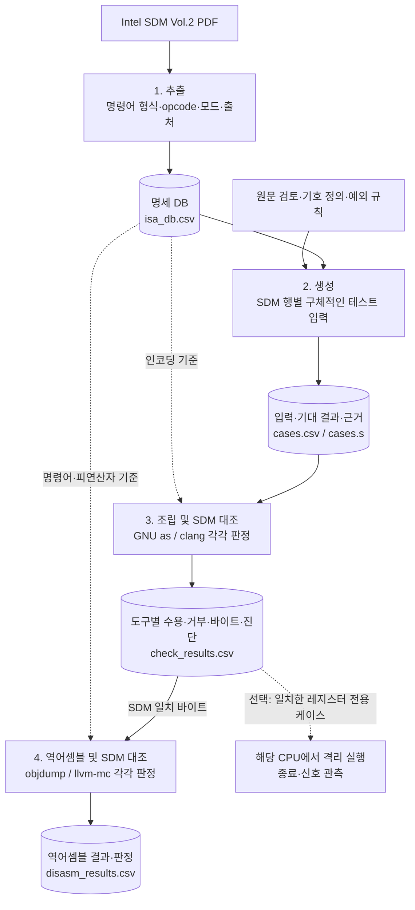
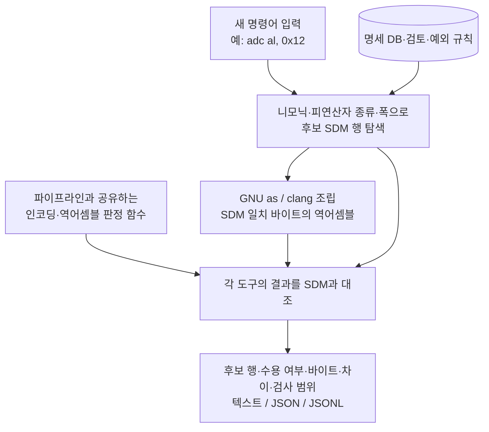
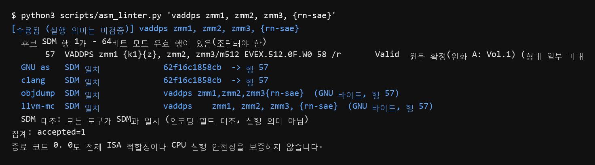

# Intel Instruction Analysis

**Intel SDM에서 테스트 입력을 만들고, 어셈블러·역어셈블러의 처리 결과가 매뉴얼과 맞는지 검사하는 프로젝트입니다.** 매뉴얼의 명령어 형식과 테스트 결과를 DB로 축적하며, 새 명령어를 CPU에서 실행하기 전에 그 입력의 형식, 조립 결과, 인코딩과 역어셈블 결과를 확인하는 도구를 제공합니다.

연구의 출발점은 “Intel 매뉴얼에 적힌 대로 명령어를 만들면 실제 도구는 어떻게 처리하는가?”입니다. 이를 확인하려면 명령어가 조립되는지에 더해, **의도한 SDM 행의 인코딩이 생성됐는지**, 그 바이트를 역어셈블했을 때 **같은 명령어와 피연산자로 해석되는지**까지 추적해야 합니다.

이 저장소는 그 과정을 **SDM 기반 테스트와 결과 축적**, **새 입력의 실행 전 검사**라는 두 흐름으로 연결합니다. 판정의 기준은 SDM이며, GNU와 LLVM의 결과를 각각 SDM에 대조합니다. 두 도구의 결과가 같다는 사실만으로 적합성을 판단하지 않습니다.

## 프로젝트가 확인하는 것

- **입력의 근거:** 어떤 SDM 행에서 만든 입력이며, 레지스터·즉시값·주소 형태를 어떤 원문 규칙에 따라 골랐는가?
- **조립 결과:** 64비트 모드에서 유효한 형식을 도구가 수용하는가? 수용했다면 목표 행의 인코딩이 나오는가?
- **역어셈블 결과:** SDM과 맞는 바이트를 각 도구가 어떤 명령어와 피연산자로 표시하는가?
- **새 입력의 검사:** 다음 실험에 사용할 명령어는 어떤 SDM 행에 대응하며, 도구는 이를 어떻게 조립하고 해석하는가?

현재 범위는 **x86-64 타깃, Intel 문법 입력, Intel SDM 093판**입니다. 입력 명령어의 CPU 실행 의미, 모든 예외 조건, 최종 레지스터·메모리 상태를 계산하는 기능까지 구현한 것은 아닙니다.

## 전체 파이프라인

SDM의 인코딩 표를 구조화한 뒤, 각 행을 시험할 구체적인 입력을 만들고 도구별 결과를 수집합니다. 원문 검토와 예외 규칙을 함께 적용해 테스트 입력 자체의 오류와 도구의 처리 차이를 구분합니다.



### 1. SDM에서 명세 DB 추출

SDM Vol.2의 인코딩 표에서 명령어 형식, opcode, 피연산자, 64비트 모드 지원 여부, CPUID 표기와 출처 페이지를 추출합니다. 결과는 [`data/db/isa_db.csv`](data/db/isa_db.csv)에 저장합니다.

분석 단위는 **명령어 이름이 아닌 SDM 표의 한 행**입니다. 같은 `MOV`라도 레지스터 폭, 메모리 형태, 즉시값 폭과 인코딩 방식이 다르면 별도 행으로 다룹니다. 원문 검토 결과와 표·설명 간 충돌은 별도 근거와 예외로 보존합니다.

### 2. 표 행을 실제 입력으로 구체화

`r32`, `imm8`, `m128` 같은 추상 표기를 실제 레지스터·값·메모리 표현으로 바꿉니다. 행에 따라 레지스터 대안, 즉시값, 기본·SIB·RIP 상대 주소, 마스크·브로드캐스트, ER/SAE 변형을 생성합니다. 가능한 모든 값의 전수 열거를 의미하지는 않습니다.

각 케이스는 `row_id`, `case_id`, 소스, 변형 이름, 기대 결과, 선택한 값의 원문 근거를 가집니다. 이를 통해 실패한 입력이 어느 표 행과 규칙에서 나왔는지 되짚을 수 있습니다.

| 생성 기대값 | 의미 |
|---|---|
| `reach` | 이 입력은 해당 SDM 행의 인코딩으로 조립돼야 함 |
| `reject` | 해당 형식은 64비트 모드에서 무효이므로 거부돼야 함 |
| `alias_no_test` | 무효 행의 입력 문법이 유효한 다른 행과 같아 소스만으로 구분해 시험할 수 없음 |

### 3. 도구별 조립 결과를 SDM과 대조

같은 입력을 GNU `as`와 `clang`에 각각 전달하고 수용·거부, 생성 바이트와 진단을 기록합니다. 수용한 입력은 접두어, 오퍼랜드 크기, REX.W, opcode 맵, opcode, ModRM 조건, 즉시값·변위 등 꼬리 길이를 해당 행과 대조합니다. ER/SAE 입력에는 관련 EVEX 필드 검사도 적용합니다.

여기서 중요한 것은 **조립 성공과 목표 인코딩 도달을 구분하는 것**입니다. 입력을 받아도 다른 SDM 행의 바이트가 나올 수 있습니다. 반대로 거부한 경우에도 무효 형식의 정상 거부인지, 유효 형식의 거부인지, 도구 기본 설정에서 꺼진 기능인지 확인해야 합니다.

`--execute`를 선택하면 SDM 일치 판정을 받은 레지스터 전용 케이스를 해당 CPU에서 격리 실행하고 종료·신호를 기록합니다. 이 관측은 조립 판정과 별도로 해석합니다.

### 4. 역어셈블 결과를 SDM과 대조

3단계에서 SDM과 일치한 바이트를 골라 `objdump`와 `llvm-mc`에 각각 전달합니다. 출력의 니모닉과 피연산자를 SDM 행 및 생성 입력에 대조하고, 별칭·암묵 피연산자·도구 관례 철자 등 처리 범위를 판정에 남깁니다.

역어셈블 문자열의 재조립 결과도 저장합니다. **SDM 대조 판정과 출력 문자열의 재조립 성공은 서로 다른 관측**입니다. 재조립 성공 여부만으로 SDM 적합성을 확정하지 않습니다.

각 단계의 구현·입출력과 규칙 파일은 [파이프라인 안내](docs/PIPELINE.md)에 정리되어 있습니다.

## 하나의 명령어가 파이프라인을 통과하는 예

다음은 **2026-10-13 전체 실행에 저장된 `case_id=6-0`**의 실제 기록입니다.

| 단계 | 입력 또는 결과 | 해석 |
|---|---|---|
| 명세 DB | 행 `6`: `ADC AL, imm8`, opcode `14 ib`, 64비트 `Valid`, 출처 PDF 127쪽 | AL과 8비트 즉시값을 사용하는 형식 |
| 생성 | `adc al, 0x12`, 기대 `reach` | AL은 표의 고정 레지스터, 즉시값은 SYM030 근거로 생성 |
| GNU as | 수용, `14 12`, `SDM 일치` | 바이트가 목표 행의 인코딩과 일치 |
| clang | 수용, `14 12`, `SDM 일치` | clang의 결과도 같은 SDM 행과 별도로 대조 |
| objdump | `adc al,0x12`, `SDM 일치` | 니모닉·피연산자 대조 통과 |
| llvm-mc | `adc al, 18`, `SDM 일치` | `18`과 `0x12`는 같은 즉시값 |
| 출력 재조립 | 두 출력 모두 `14 12` | 재조립 바이트 보존도 별도로 관측 |

기록은 [생성 케이스](out/cases/cases.csv), [조립 판정](out/cases/check_results.csv), [역어셈블 판정](out/cases/disasm_results.csv)에서 같은 `case_id`로 연결됩니다.

이 사례에서 확인한 것은 입력과 인코딩·표시의 대응입니다. 덧셈 결과와 플래그 변화까지 검증했다는 뜻은 아닙니다.

## DB와 결과를 새 명령어 검사에 활용하기

프로젝트의 데이터는 다음 세 종류로 나뉩니다.

| 데이터 | 담는 내용 | 활용 |
|---|---|---|
| 명세 DB·규칙 | SDM 형식, 인코딩, 모드, 출처, 검토·예외 | 생성과 새 입력의 후보 탐색·판정 기준 |
| 테스트 입력 DB | 구체적인 소스, 기대값, 변형, 원문 근거 | 같은 조건의 재현과 생성 입력 추적 |
| 테스트 결과 DB | 도구별 수용·거부, 바이트, 진단, 역어셈블 결과 | 실제 처리 결과 조회와 차이 분석 |

[`scripts/asm_linter.py`](scripts/asm_linter.py)는 새 명령어의 실행 전 검사를 제공합니다. 명세 DB에서 후보 행을 찾고, 파이프라인 3·4단계와 같은 함수를 사용해 현재 도구의 처리 결과를 판정합니다. **입력 명령어를 CPU에서 실행하지 않으며, 조립·역어셈블 도구는 실제로 호출합니다.**



예를 들어 다음 실험에서 사용할 명령어를 한 줄씩 검사하거나, 파일의 여러 명령어를 독립적으로 검사할 수 있습니다.

```bash
# 한 명령어의 후보 행과 도구별 SDM 판정
python3 scripts/asm_linter.py 'adc al, 0x12'

# 파일 내 명령어를 한 줄씩 검사하고 JSON으로 출력
python3 scripts/asm_linter.py --file examples/fuzz_inputs.s --format json

# 매뉴얼 원문과 저장된 테스트 사례 조회
python3 scripts/manual_lookup.py show ADC --part Description
python3 scripts/manual_lookup.py cases ADC --opcode '14 ib'
```

ER/SAE 입력의 보존된 CLI 출력 예도 확인할 수 있습니다.



도구를 호출하지 않는 `--static-only` 모드는 후보 형태만 비교하고 결과를 미완료로 남깁니다. 파일 검사는 각 명령어를 독립적으로 다루며 프로그램 전체의 제어 흐름·링크를 검증하지 않습니다. API와 옵션은 [도구 안내](docs/TOOL_GUIDE.md)를 참고하세요.

## 결과를 읽는 방법

관측과 판정은 다음 순서로 구분해 읽어야 합니다.

| 확인할 항목 | 알 수 있는 것 | 해석 범위 |
|---|---|---|
| 후보 SDM 행·생성 근거 | 입력이 어떤 형식에 대응하는지 | 형태 일부가 미대조이거나 후보가 여러 개일 수 있음 |
| 수용·거부 | 해당 버전·설정의 어셈블러가 입력을 처리했는지 | 수용만으로 목표 인코딩 도달을 확정할 수 없음 |
| 인코딩 `checked` / SDM 일치 | 구현된 인코딩 필드 검사를 통과했는지 | 부분 검사이며 전체 ISA 적합성을 뜻하지 않음 |
| 역어셈블 판정 | 바이트의 출력 표기가 비교 기준과 맞는지 | 판정 이름에 적힌 미대조 범위도 함께 확인 |
| CPU 종료·신호 | 해당 CPU·OS·초기 조건에서 관측한 결과 | 모든 환경의 실행 가능성이나 의미를 보증하지 않음 |

SDM과 다른 결과는 **검토할 차이**입니다. 생성 입력 오류, 문법 별칭, 도구 설정·지원 범위, 원문 충돌, 도구 결함 후보를 근거와 함께 구분합니다. 차이가 발견됐다는 이유만으로 자동으로 버그라고 집계하지 않습니다.

CLI의 `accepted`는 GNU가 수용했고 모든 도구가 검사 범위에서 SDM과 일치하며 추가 확인 사항이 없는 상태입니다. `needs_review`는 수용했지만 확인할 항목이 있는 상태, `rejected`는 GNU가 거부한 상태입니다. 기대된 거부인지도 도구별 SDM 판정에서 확인해야 합니다.

CLI 종료 코드 `0`은 모든 입력이 `accepted`, `1`은 거부 또는 검토 항목, `2`는 미완료·설정·도구 오류 등을 뜻합니다. `accepted`나 종료 코드 `0`도 CPU 실행 안전성을 보증하지 않습니다.

## 현재 실험 결과

**2026-10-13 전체 실행** 기준입니다. 환경은 WSL2 Ubuntu, GNU Binutils 2.47, LLVM 23.1.3이며 CPU 관측 환경은 Intel Core Ultra 5 226V입니다.

| 항목 | 결과 |
|---|---|
| SDM 표 행 / 니모닉 | 4,219 / 1,617 |
| 생성 케이스 | 21,046개, ER/SAE 변형 1,598개 포함 |
| 조립 SDM 일치 | GNU as 20,934 / clang 20,696 |
| 역어셈블 대조 | 대상 20,844개, 일치 계열 objdump 20,763 / LLVM 20,767 |
| 생성 케이스와 CLI의 판정 대조 | 21,046개 모두 생성 행을 후보에 포함, 조립 SDM 일치 37,298건을 같은 행으로 판정 |
| 코드 회귀 검사 | 2026-10-19 WSL에서 156개 통과, 건너뜀 없음 |

이 수치는 현재 생성·검사 범위의 결과이며 ISA 전체에 대한 검증 완료율이 아닙니다. 전체 실행의 기록은 [`out/runs/20261013T025438835844Z.json`](out/runs/20261013T025438835844Z.json)에 있고 코드·입출력·도구 해시를 포함합니다.

ER/SAE 개발 중 별도 생성한 snapshot은 21,060개이며, 이후 r64 변형 14개를 제거한 전체 실행은 21,046개입니다. 각 snapshot의 생성 범위와 실제 조립·재판정 범위를 구분해야 합니다. 상세는 [ER/SAE 지원 기록](docs/ER_SAE_SUPPORT.md), 원문·도구 차이의 재점검은 [발표 전 검토](docs/PRESENTATION_REVIEW_2026-10-13.md)에 정리했습니다.

## 실행 환경과 재현

Linux 또는 WSL Ubuntu에서 Python 3.10 이상과 GNU Binutils(`as`, `ld`, `objdump`, `objcopy`, `readelf`), `clang`, `llvm-mc`를 사용합니다. 시험한 도구 경로는 [`pipeline/toolchain.py`](pipeline/toolchain.py)에 모여 있습니다.

```bash
# 설치된 도구 경로에 맞게 지정
export BINUTILS_BIN="$HOME/opt/binutils-2.47/bin"
export LLVM_BIN="$HOME/opt/llvm-23.1.3/bin"

# 실행 단계 확인
python3 pipeline/run.py --list

# 저장된 명세 DB·검토 결과에서 생성 → 조립 판정 → 역어셈블 대조
python3 pipeline/run.py generator --until disasm

# 코드 회귀 검사
python3 -m unittest discover -s tests -p 'test_*.py' -q
```

위 파이프라인 명령은 기본 `out/cases/` 결과를 갱신합니다. 기존 실험을 보존하고 비교할 때는 별도 작업 사본이나 단계별 출력 경로를 사용하세요. 실행기는 `out/runs/<UTC>.json`에 실행 범위와 코드·입출력·도구 정보를 기록합니다.

PDF 추출부터 수행하려면 SDM 093판 `intel_manual.pdf`와 `pdfplumber`가 필요합니다. 매뉴얼 원문 조회용 색인을 만들려면 Vol.1·Vol.2 PDF와 `pypdfium2`를 준비합니다. PDF·매뉴얼 색인은 저장소에 포함하지 않습니다. 저장된 명세 DB를 사용하는 생성·판정은 PDF 추출 이후 단계부터 시작할 수 있습니다.

CPU 관측은 `python3 pipeline/run.py --only check --execute`로 선택합니다. Windows PowerShell에서는 Linux 명령 앞에 `wsl -d Ubuntu --`를 붙이거나 WSL 터미널에서 실행하세요.

## 저장소 안내

| 경로 | 내용 |
|---|---|
| [`pipeline/`](pipeline/) | 추출·생성·조립 판정·역어셈블 대조, CLI와 공유하는 검사 함수 |
| [`data/db/`](data/db/), [`data/rules/`](data/rules/) | SDM 명세 DB, 기호·예외·보정 규칙 |
| [`out/cases/`](out/cases/) | 현재 전체 실행의 입력·도구 관측·판정 |
| [`out/sdm_review_093/`](out/sdm_review_093/), [`out/sdm_evidence_093/`](out/sdm_evidence_093/) | SDM 원문 검토와 행별 근거 |
| [`out/runs/`](out/runs/) | 실행별 manifest |
| [`scripts/`](scripts/), [`examples/`](examples/), [`tests/`](tests/) | CLI·조회 도구, 입력 예제, 회귀 검사 |
| [`docs/`](docs/) | 파이프라인·사용법·검토 기록·발표 자료 |

구현과 파일을 따라가려면 [파이프라인 안내](docs/PIPELINE.md), 도구를 사용하려면 [CLI 안내](docs/TOOL_GUIDE.md), 작업 상태와 후속 검토 항목은 [HANDOFF](docs/HANDOFF.md), 변경 이력은 [DEVLOG](docs/DEVLOG.md)를 참고하세요.
